# Лабораторная П02. Автоматизация в Linux

## Задание
Написать bash-скрипт, который принимает город параметром и выводит температуру и влажность. Установить nginx. Запускать скрипт по cron раз в минуту и сохранять вывод в `index.html` дефолтного сайта.

## Окружение
- Ubuntu Server 24.04 (arm64) в VirtualBox, хост: macOS (Apple Silicon)
- nginx, jq, curl, cron
- Источник данных: [wttr.in](https://github.com/chubin/wttr.in) (формат JSON, `format=j1`)
- Проброс портов: `127.0.0.1:2222 → 22` (SSH), `127.0.0.1:8080 → 80` (HTTP)

## Файлы репозитория
- `weather.sh`: скрипт получения погоды
- `crontab.txt`: задание планировщика (`crontab -l`)
- `screenshots/`: скриншоты выполнения

## 1. Установка nginx
Установлены `nginx`, `jq` и `curl` (`sudo apt install -y nginx jq curl`). Сервер проверен командой `curl 127.0.0.1`, в ответе страница «Welcome to nginx!».

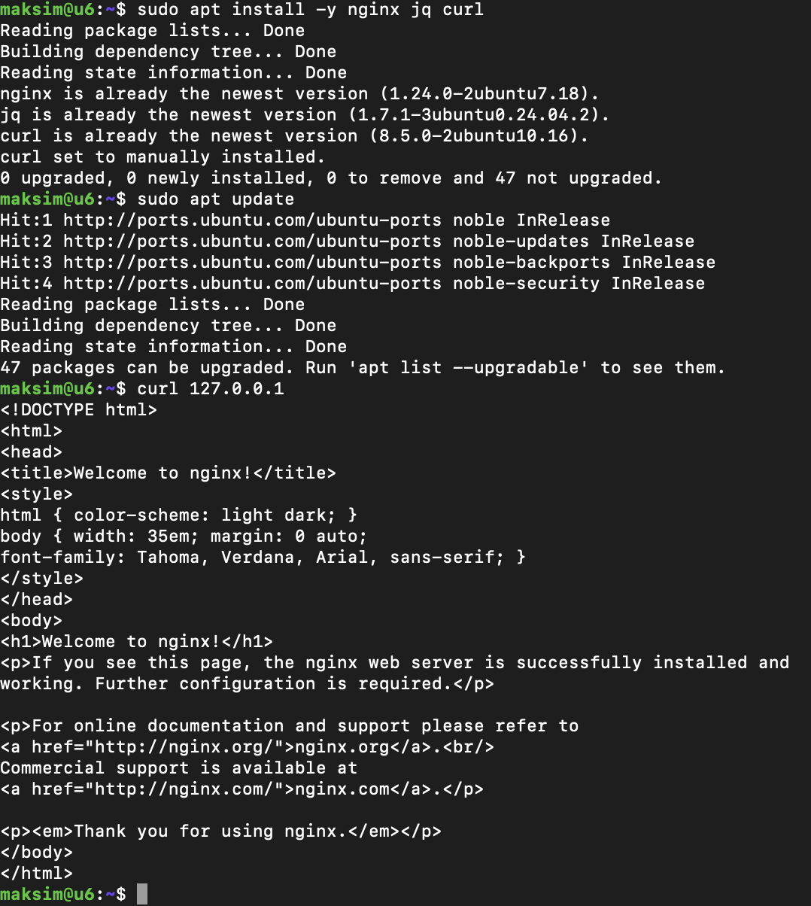

## 2. Проброс порта 8080 → 80
В VirtualBox (Сеть → Адаптер 1 → Проброс портов) добавлено правило `http`: хост `127.0.0.1:8080`, гость `10.0.2.15:80`. Правило `ssh` (2222 → 22) осталось с прошлой работы.

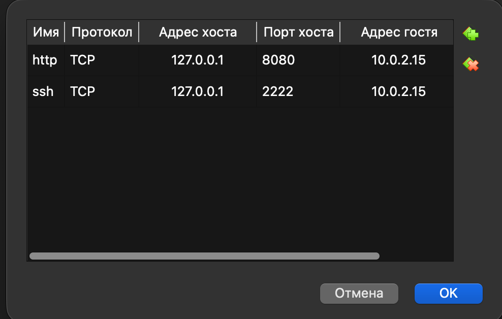

Страница nginx открывается в браузере хоста по адресу `http://127.0.0.1:8080`.

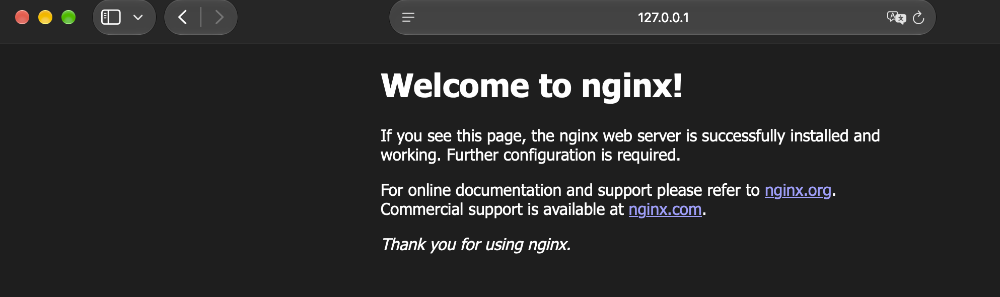

## 3. Проверка источника данных и jq
Запрос `curl -s "wttr.in/Perm?format=j1"` возвращает JSON. Через `jq` из блока `current_condition[0]` извлечены температура (`temp_C`) и влажность (`humidity`).

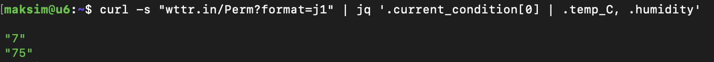

## 4. Скрипт weather.sh
Скрипт принимает город первым параметром (`$1`), запрашивает погоду, извлекает температуру и влажность через `jq` и выводит HTML-страницу в stdout. Если данные получить не удалось, скрипт завершается с кодом 1 и сообщением в stderr. Скрипт сделан исполняемым (`chmod +x`). Полный текст: [weather.sh](weather.sh).

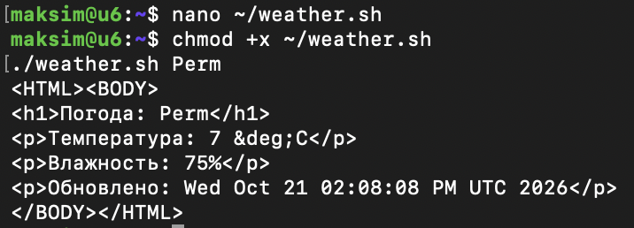

При первом открытии страницы русский текст отображался неправильно. Причина: в HTML не была указана кодировка. Добавлен тег `<meta charset="UTF-8">`, после этого текст отображается корректно.

## 5. Права на index.html
Файл `/var/www/html/index.nginx-debian.html` принадлежит root, а cron выполняется от обычного пользователя. Запись в файл разрешена командой `sudo chmod a+w`.

До:

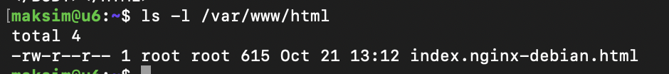

После:

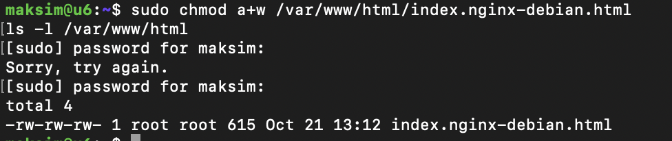

## 6. Планировщик cron
В `crontab -e` добавлено задание, которое каждую минуту запускает скрипт для города Perm. Результат пишется во временный файл `/tmp/w.html` и копируется в `index.nginx-debian.html` только при успешном выполнении (`&&`). Так при сбое сети старая страница не затирается пустой.

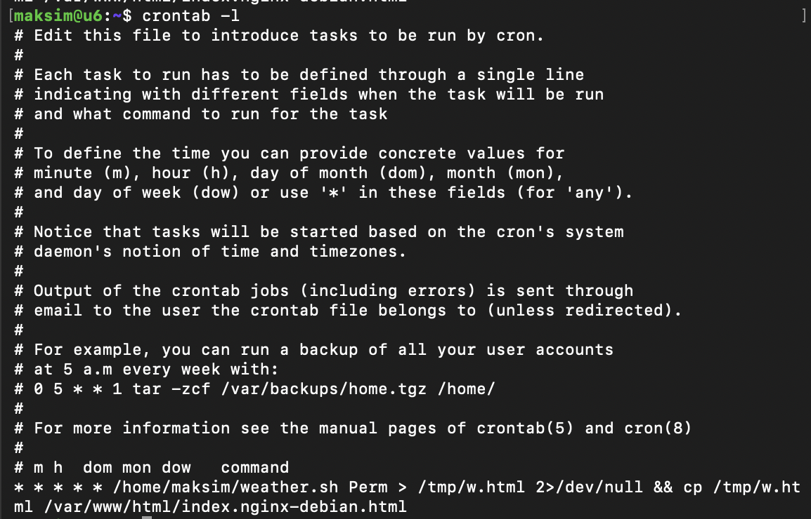

Файл с заданием: [crontab.txt](crontab.txt).

## 7. Проверка работы
Команда `curl 127.0.0.1` с интервалом в минуту: значение в строке «Обновлено» меняется, значит, cron обновляет страницу.

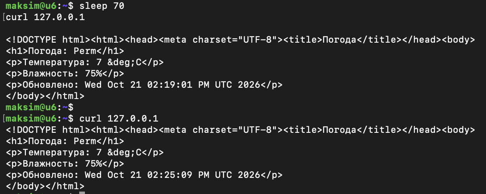

Страница в браузере (`http://127.0.0.1:8080`) в два момента времени:

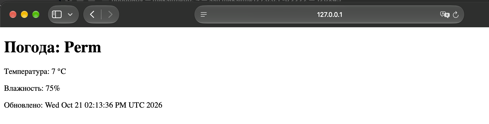

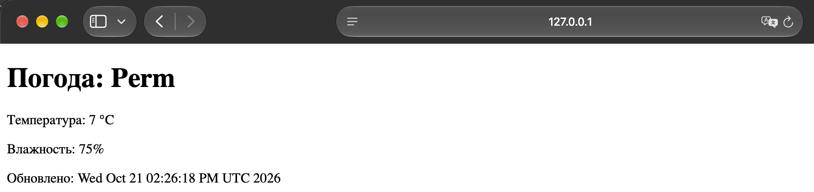

## Использованные команды
```bash
sudo apt update
sudo apt install -y nginx jq curl
curl 127.0.0.1
curl -s "wttr.in/Perm?format=j1" | jq '.current_condition[0] | .temp_C, .humidity'
chmod +x ~/weather.sh
./weather.sh Perm
sudo chmod a+w /var/www/html/index.nginx-debian.html
crontab -e
crontab -l
```

## Выводы
Установлен веб-сервер nginx, написан bash-скрипт, получающий погоду из JSON-API с разбором через `jq`, настроен запуск по cron раз в минуту с обновлением страницы сайта.
